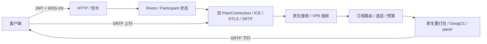

# livekit-cpp 媒体服务设计

版本：v0.1；日期：2026-10-26；读取基线：`da4732d`。本文区分已有单机 RTC 实现与后续服务化目标。

平台业务服务位于 `livekit-server`；本仓库负责媒体控制和媒体数据面。当前可执行文件名 `livekit-server` 保留，部署标识建议用 `livekit-media`。总体边界见 [平台设计](../../docs/platform-design.md)。

## 1. 当前能力与限制

现有 C++20 服务提供 `/rtc` 双 PeerConnection 信令、JWT 授权、RoomService 子集、Opus/VP8/RTX SFU、最多三层 VP8 simulcast 选层、数据通道、原生 GoogCC/pacing 和 coturn REST 凭证。默认 `media_mode=sfu`；旧 `relay` 解码重编码模式只作兼容，不等于 MCU。

Windows 与 Linux x64 服务端有构建和局部媒体测试证据，但文件四轨与 Windows→Linux/WSL 仍存在失败，不能宣称生产就绪、容量达标或全部弱网通过。现状和原始验收以 [交接记录](STATUS_AND_HANDOFF.md)、[兼容矩阵](COMPATIBILITY.md)、[VALIDATION](../VALIDATION.md)为准。

未交付 `/rtc/v1`、无缝重连、Redis 集群、内置 TURN、项目级隔离、完整 Webhook、Egress/Ingress/SIP/Agent 后端、云录制与合流。底层库支持某编码/FEC 不意味着服务已经接入。

## 2. 模块与状态归属

| 文件 | 职责 |
| --- | --- |
| `src/main.cpp`、`config.cpp` | 启动、配置、依赖装配与退出 |
| `src/http.cpp` | Boost.Beast HTTP/WebSocket、Twirp 编解码、请求边界 |
| `src/auth.cpp` | JWT、权限与 ID |
| `src/rooms.cpp` | 房间、参与者、发布订阅、管理 API 和生命周期 |
| `src/rtc.cpp` | WebRTC 工厂、双 PeerConnection、ICE/DTLS 与数据 |
| `src/sfu.cpp` | SFU 路由、订阅状态、分层和带宽策略 |
| `src/native_rtp.cpp`、`native_send_transport.cpp` | 原生 RTP 适配、发送反馈与 pacing 集成 |
| `src/turn.cpp` | coturn REST 临时凭证 |
| `src/codec_audit.cpp` | 编解码使用审计，验证 SFU 不执行视频编解码 |

房间业务状态在单个 Asio 事件循环串行修改；原生媒体运行于 WebRTC network/worker/signaling 线程，回调投递回事件循环。媒体内部状态按其网络线程归属操作，不由 HTTP 线程直接修改。弱引用与任务安全标记保护关闭后的异步回调。

## 3. 信令与媒体数据流

VP8 完整组帧后重新打包，编码内容保持不变；每个订阅维护独立 picture ID、RTP 序号和时间戳映射。该实现虽无视频转码，仍有组帧等待和复制成本，延迟/吞吐必须实测，不能等同于零拷贝逐包直通。

原生模块承担 RTP/RTCP、NACK/RTX、PLI、重传缓存、TWCC/REMB、拥塞控制及 pacing。默认 PeerConnection 媒体通道的发送接口已撤下，保留 BaseChannel 的 ICE/DTLS/SRTP，避免重复发送 RTCP/TWCC。禁止在应用层再维护一套协议栈。

## 4. 订阅与带宽策略

发布者最多三层 VP8 simulcast；订阅者以 quality 或目标尺寸表达上限，最终层由源可用性和带宽预算决定。首次订阅、恢复及目标层切换必须处理关键帧依赖。单层发布不能凭空产生低层；原生 SDK 当前没有已验收的多层发布能力。

现有实现每 200 ms 分配原生目标码率的 85%，先给音频预留至少 64 kbps/轨（测得需求更高时按需），再给视频基础层与更高优先级层。普通升层/恢复要求余量持续满足条件，降层和停发层回退更快执行；具体例外和阈值见 README，本文不重复定义第二套算法。

每传输应用媒体准入预算为 4 MiB，视频整帧接受或拒绝；拒绝后请求关键帧。原生 TTL 和重传生命周期继续生效。这个上限不代表整个进程内存固定，房间数、订阅扇出、编码帧缓存和重传历史还需分别测量与限制。

暂停、静音、退订、移除应清理对应排队数据，不能在恢复后发送长时间过期媒体。现有 pacer 暂停/TTL 补丁是正确性依赖，不能通过增大 TTL 或移除断言规避失败。

## 5. 授权、房间与数据

入房验证签名、issuer、exp/nbf、房间和发布/订阅/数据权限。房间创建/更新等管理 API 使用管理权限。业务服务负责用户角色和项目政策，本服务执行收到的媒体权限；暂不支持的限制明确拒绝。

当前房间、参与者和媒体轨道状态驻内存，进程重启会丢失活动会话。重复 identity 会替换旧连接；业务层应区分多设备身份。房间容量、空房超时、心跳超时和退出清理由本服务执行。

reliable/lossy 数据通道支持认证发送者与指定接收者。可靠通道为有界发送队列；可靠传输不表示业务执行一次且仅一次，远控/任务协议仍需自己的序号、幂等和授权。数据权限不能直接授权系统输入。

当前没有完整项目级隔离；房间名加项目前缀仅防冲突。强隔离部署采用独立实例/密钥，管理入口不暴露给普通客户端。后续项目级 ACL、配额和密钥轮换必须在媒体端真正执行后再开放业务 API。

## 6. TURN、网络和关闭

coturn 独立部署；当前支持静态 ICE 配置与初次/完整入房签发 REST 临时凭证。共享密钥不进入客户端配置；在线刷新、即时吊销和无损轮换尚未交付。TURN/TLS、公网 NAT、跨网络与长通话需要分别验收。

当前默认 TCP 信令端口 7880，ICE UDP 50000–50100，部署以配置为准。公网入口配置 HTTPS/WSS 和可达媒体候选，不由反向代理 HTTP 成功推导媒体可达。`/healthz` 表示进程健康，不等于媒体质量达标；`/metrics` 当前要求 roomList 权限。

目标关闭顺序：停止新连接/任务 → 标记实例不可调度 → 有界等待或主动结束房间 → 停止源与订阅 → 取消计时任务和待投递回调 → 释放原生传输/线程 → 退出。当前有退出清理，完整 drain 与滚动迁移仍是后续能力。

## 7. 后续 worker 架构

媒体 worker 独立进程，避免慢编码、磁盘或外部网关阻塞 SFU。业务服务拥有任务记录、调度策略、配额和资产可见性；worker 获取租约后执行媒体处理并回报，不自行决定用户权限。

| worker | 目标能力 | 完成标准 |
| --- | --- | --- |
| RU 录制 | 分轨记录、统一时间线 manifest、上传/恢复 | 真实媒体可回放，时间基和缺口可解释 |
| MCU | 音频混音/mix-minus、布局合成、输出编码 | 真实合成输出、布局/音轨正确、长时间 AV 同步 |
| 直播网关 | RTMP/WHIP 输入、RTMP/RTMPS 输出 | 外部端到端互通、断线策略和资源回收 |

worker 协议包含 job_id、attempt、租约和 fencing token，输出写入 attempt 专属临时路径。持过期租约的 worker 不能提交结果；幂等提交由业务服务验证。取消停止输入后排空或丢弃输出按任务类型决定，不能将半成品登记为成功资产。

现有 decoded relay、SDK 本地 WAV/Y4M 和 CLI 流输入均不替代这些 worker。可复用底层采集/编解码能力，但需独立进程、任务模型和故障验收。

## 8. 规模化与兼容演进

首期保持单房间单 SFU，依据 CPU、内存、出口和房间扇出测定容量。后续由业务调度层选择实例，新增实例注册、负载心跳、拒绝新房和 drain。单机内存模型不能仅通过加 Redis 获得媒体迁移能力；节点失效先按完整重连设计。

协议、官方 SDK、WebRTC 和原生补丁固定版本，升级先做兼容测试。媒体服务与 SDK 的 protobuf 形态不同，使用同一行为测试验证字段与权限，不能只比较能否解析。对新增编码/FEC/单连接协议逐项启用，未验证不协商宣告。

## 9. 验证与实施顺序

先关闭 [交接记录](STATUS_AND_HANDOFF.md)中的文件四轨帧数、跨系统 LOW 超时和 HTTP 401，再扩展设备、运维与 worker。HTTP 401 先查凭证和时间，不当作媒体解码故障。

现有验证覆盖原生 CTest、浏览器真实解码、SDK/CLI、TURN 和队列补丁；入口见 [README](../README.md)。升级 WebRTC 必须通过 `native-send` 链接库回归，源码哈希正确不证明预编译库正确。

新增验收覆盖弱网、首帧/端到端时延、音频连续性、重连、100 并发真实媒体与 24 h 稳定性，记录环境、样本和二进制哈希。worker 增加两小时 AV 偏差、故障恢复、取消与产物校验。性能目标沿用总体设计与原实施规划，本次未执行或宣称这些测试通过。
